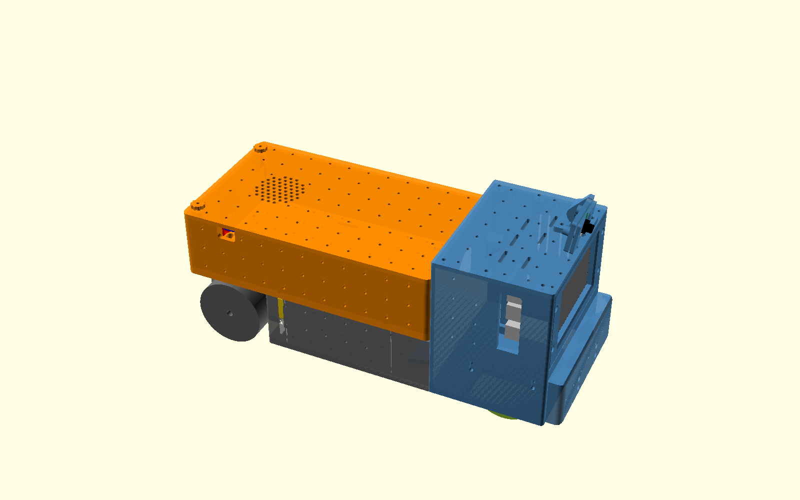

# Robothector chassis (OpenSCAD)

Parametric 3-part truck body: **cabin** (Pi 4 + Waveshare 4.3" DSI, camera, omni-wheels),
**upper carriage** (power bank, L298N, PD trigger, speaker), **lower carriage** (frame + 2 TT motors).
Design spec: [`docs/superpowers/specs/2026-10-17-chassis-redesign-design.md`](../docs/superpowers/specs/2026-10-17-chassis-redesign-design.md).

## Files

| File | What |
|---|---|
| `robothector_base.scad` | **Single source of truth**: frame, global dimensions, joint coordinates (J1/J2/J3, passages), hole sizes, grid, adapter plates, printed M5 thread |
| `vitamins.scad` | Ghost models of bought parts (`v_*`), used for fit checks and renders only |
| `fit_checks.scad` | ~30 assertions over the constants; run after any parameter change |
| `fit_test.scad` | Test coupon: print first, then tune the hole sizes |
| `cabin*.scad`, `upper_carriage*.scad`, `lower_carriage*.scad` | `*_base.scad` = modules; `*.scad -D part="..."` = one printable in print orientation |
| `assembly.scad` | Everything in place: `-D show="all" \| "exploded" \| "parts" \| "vitamins"` |
| `tools/export_all.sh` | Export and check every printable into `stl/` (manifold, bed size, on Z = 0) |
| `tools/make_3mf.py [--check]` | Build the PrusaSlicer print plates in `3mf/`; `--check` slices each one (PETG, its layer profile) and writes ready G-code to `~/cad/slices/robothector/plates/` |
| `tools/interference.py` | Pairwise intersection of assemblies and ghost parts (must be < 1 mm³) |
| `tools/joint_probe.sh` | Bolt probes through J1/J2/J3: proves the holes line up (`joint_probe.sh 2` is the negative control) |

Coordinates: X forward, Y left, Z up; Z = 0 ground, X = 0 is the cabin/carriage bulkhead plane.

## Print first: the fit coupon

`3mf/00-fit_test-coupon_0.30mm.3mf` (PETG, 0.30 mm like the big parts, 4 perimeters, no supports, about 1 h 47 min, 28 g).

| Feature | Pick | Then set in `robothector_base.scad` |
|---|---|---|
| M3 pilots 2.5/2.6/2.7/2.8 (vertical bosses + horizontal cubes) | Smallest one an M3 drives by hand without splitting | `m3_tap_d` |
| M5: printed thread `T5` vs pilots 4.1/4.3 | Whether the printed thread takes a screw cleanly, in each orientation | `m5_pilot_d`, `m5_mode_vertical`, `m5_mode_horizontal` (J1/J3 holes are horizontal) |
| 2 mm rod holes 2.0/2.2/2.4 | The one the rod slides through freely | `OMNI_rod_hole_d` |
| Dovetail 0.15/0.25/0.35 | Slides in by hand without rattling | `clr_slide` |

Then run `openscad -o /tmp/x.echo fit_checks.scad`, `tools/export_all.sh` and `tools/make_3mf.py --check` to regenerate the STLs and plates.

## Print plates (3MF)

Ready-to-open PrusaSlicer plates in `3mf/`: every part is its own object, already oriented and arranged on the MK3S+ bed.
They carry no print settings (same as the other 3MFs in `~/cad`), so pick **Generic PETG, 4 perimeters, 15 % gyroid, supports off**
and the layer profile in the file name. Times are PrusaSlicer estimates at those settings.

| Plate | Profile | Time | Filament |
|---|---|---|---|
| `00-fit_test-coupon_0.30mm` | 0.30mm DRAFT | 1 h 47 | 28 g |
| `01-cabin-body_0.30mm` | 0.30mm DRAFT | 14 h 59 | 357 g |
| `02-upper_carriage-tray_0.30mm` | 0.30mm DRAFT | 13 h 17 | 300 g |
| `03-upper_carriage-lid_0.30mm` | 0.30mm DRAFT | 6 h 30 | 109 g |
| `04-lower_carriage-frame_0.30mm` | 0.30mm DRAFT | 11 h 56 | 251 g |
| `05-cabin-panels_0.20mm` (roof, faceplate, bumper) | 0.20mm SPEED | 8 h 50 | 116 g |
| `06-cabin-small_0.20mm` (retainer, 2 cassettes, camera parts) | 0.20mm SPEED | 5 h 30 | 73 g |
| `07-upper_carriage-small_0.20mm` (3 posts, 3 pushers, 2 stops, 5 knobs, plates, speaker ring) | 0.20mm SPEED | 5 h 51 | 68 g |
| `08-lower_carriage-clamps_0.20mm` (2 clamps, 2 caps) | 0.20mm SPEED | 4 h 55 | 60 g |

Total about 73.5 h and 1.36 kg. Print the coupon at 0.30 mm like the big parts: they carry most of the pilot and M5 holes.

## Print table

PETG, 4 perimeters, 15 % gyroid, **no supports**. Times are PrusaSlicer estimates on an MK3S+.

| Part | Qty | Orientation | 0.20 mm SPEED | 0.30 mm DRAFT |
|---|---|---|---|---|
| cabin-body | 1 | upright, floor down | 23 h 35 | 14 h 59 |
| cabin-roof | 1 | flat | 3 h 22 | |
| cabin-faceplate | 1 | face down | 2 h 03 | |
| cabin-screen_retainer | 1 | flat | 0 h 52 | |
| cabin-bumper | 1 | rear face down | 3 h 27 | |
| cabin-omni_cassette | 2 | roof down | 1 h 42 each | |
| cabin-camera_bracket / cradle / clip | 1 each | as exported | 1 h 34 total | |
| upper_carriage-tray | 1 | floor down | 19 h 52 | 13 h 17 |
| upper_carriage-lid | 1 | top face down | 7 h 54 | 6 h 30 |
| upper_carriage-clamp_post | 3 | base down | 28 min each | |
| upper_carriage-pusher | 3 | as exported | 12 min each | |
| upper_carriage-rear_stop | 2 | base down | 47 min each | |
| upper_carriage-knob | 5 | cap down | 6 min each | |
| upper_carriage-l298n_plate / pd_plate / speaker_ring | 1 each | flat side down | 2 h 08 total | |
| lower_carriage-frame | 1 | floor down, long side along bed X | 16 h 35 | 11 h 55 |
| lower_carriage-tt_clamp + tt_clamp_mirror | 1 + 1 | base down | 1 h 56 each | |
| lower_carriage-tt_cap | 2 (flip one) | flat | 31 min each | |

Total at 0.20 mm everywhere: about 94 h and 1.28 kg. Printing the four big parts at 0.30 mm brings it to about 72 h.
(The first version on a 10 mm grid was about 111 h; the big parts' time is now mostly their solid 4 mm walls.)

## Hardware (bill of materials)

| Item | Qty | Where |
|---|---|---|
| M3×5 | 4 | L298N board to its plate |
| M3×8 | 16 | clamp posts (6), L298N plate (4), PD plate (2), speaker ring (4) |
| M3×10 | 3 | camera bracket to roof grid |
| M3×12 | 30 | roof (6), faceplate (4), camera clip (2), lid thumbscrews (2), side set screws (2), TT clamps to floor (6), TT caps (8) |
| M3×16 | 22 | J2 tray to frame (6), omni cassettes (8), screen retainer (2), camera pivot (1), front set screw (1), rear stops (4) |
| M3×20 | 4 | bumper |
| M3×25 | 0–6 | optional, through the TT gearbox holes; also set screws for small banks |
| M5×20 | 4 | J1 cabin to frame (2, heads inside the cabin), J3 tray to bulkhead (2, heads inside the tray) |
| 2 mm steel rod, ~37 mm | 2 | omni-wheel axles (trapped by the well walls, no collar) |
| 20 mm hook-and-loop strap, ~350 mm | 1–2 | power bank hold-down |
| Foam tape 1–3 mm | some | bank pusher pads (1 mm), screen retainer, TT cap |
| Zip tie | 1 | PD trigger |
| Right-angle USB-C / USB-A leads | 2 | bank to PD trigger, bank to Pi |

Set-screw lengths depend on the bank: `uc_clamp_report([L, W, H])` in `upper_carriage_base.scad` echoes the grid nodes and screw lengths for any bank.

## Assembly order

1. **Cabin internals:**
   - Put each omni-wheel and its 2 mm rod in a cassette.
   - Screw the cassettes into the wells (M3×16, mid-slot), and screw the bumper on (M3×20).
   - Clamp the screen + Pi into the faceplate with the retainer (M3×16).
   - Connect the DSI ribbon, the camera ribbon, the right-angle USB-C and the GPIO jumpers.
   - Screw the faceplate on (M3×12).
2. **Lower carriage:**
   - Drop each TT motor into its clamp. Optionally fit M3×25 through the gearbox from inboard: do this on the bench, because the spine blocks the heads later.
   - Fit the caps (M3×12), bolt each clamp to the floor grid (3× M3×12; the cap leaves the heads reachable), and push the wheels on.
3. **J1, cabin to lower carriage:**
   - Stand the cabin with the roof off, and lower the frame straight down onto the dovetail tongue.
   - From inside the cabin, drive 2× M5×20 through the bulkhead pads.
4. **Upper carriage:**
   - Thread the strap through the floor slots first; it runs under the floor through the frame's front bay.
   - Fit the L298N plate, PD plate, rear stops and clamp posts.
   - Set the tray on the frame and fix J2 with 6× M3×16 from inside the tray.
   - Fix J3 with 2× M5×20 from inside the tray into the bulkhead.
5. **Power bank:**
   - Put the bank in, ports to the rear.
   - Turn the set-screw knobs until it's snug, then strap it.
   - Hook the lid on at the front and fit the 2 rear thumbscrews.
6. **Roof:**
   - Feed the camera ribbon through the roof slot, and screw the roof on (6× M3×12).
   - Mount the camera bracket on the roof grid and set the tilt.

## Adding things later

Every free surface carries M3 pilot holes on a **20 mm grid aligned to the global frame** (`grid_pitch`).
Mounts that need finer positions (bank clamps, motor clamps) have slotted feet. To add a board, call
`adapter_plate([w, d], [[x, y], ...], standoff_h, pilot_d(screw))` with the board's hole coordinates and print it.
The plate's own holes land on grid nodes. For boards with odd or unknown holes, use `slotted_plate([w, d])`.
A different drive motor needs a new clamp on the motor-zone floor grid. A different front wheel needs a new
`omni_cassette`.
